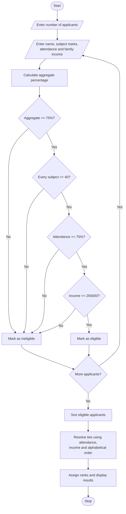

# University Scholarship Allocation System Using Python

## 1. Problem Statement
University Scholarship Allocation: Design a system that evaluates applicants using aggregate 
marks, subject-wise minimum scores, attendance, and income criteria, ranks eligible students, and 
resolves ties using predefined rules. 
## 2. Algorithm

1. Start the program.
2. Read the number of applicants.
3. For each applicant, input their name, subject-wise marks, attendance percentage, and annual family income.
4. Calculate aggregate percentage using the average of subject marks.
5. Check all four eligibility conditions:
   - Aggregate percentage is at least 75%.
   - Every subject mark is at least 40.
   - Attendance is at least 75%.
   - Annual family income does not exceed ₹2,50,000.
6. If all conditions are satisfied, mark the applicant as eligible; otherwise, mark them as ineligible and record the reasons.
7. Sort eligible applicants using the following priority:
   - Aggregate percentage in descending order.
   - Attendance percentage in descending order.
   - Annual family income in ascending order.
   - Applicant name in alphabetical order.
8. Assign ranks to eligible applicants.
9. Display the ranked merit list and the ineligible applicants with their rejection reasons.
10. Stop the program.

## 3. Flowchart Using Mermaid


## 5. Sample Input

```
Enter number of applicants: 4

Enter details for applicant 1
Name: Anu
Number of subjects: 3
Marks in subject 1 (0-100): 90
Marks in subject 2 (0-100): 80
Marks in subject 3 (0-100): 85
Attendance percentage (0-100): 90
Annual family income (Rs.): 200000

Enter details for applicant 2
Name: Ravi
Number of subjects: 3
Marks in subject 1 (0-100): 90
Marks in subject 2 (0-100): 80
Marks in subject 3 (0-100): 85
Attendance percentage (0-100): 95
Annual family income (Rs.): 220000

Enter details for applicant 3
Name: Meena
Number of subjects: 3
Marks in subject 1 (0-100): 70
Marks in subject 2 (0-100): 75
Marks in subject 3 (0-100): 80
Attendance percentage (0-100): 80
Annual family income (Rs.): 150000

Enter details for applicant 4
Name: Kiran
Number of subjects: 3
Marks in subject 1 (0-100): 90
Marks in subject 2 (0-100): 30
Marks in subject 3 (0-100): 85
Attendance percentage (0-100): 90
Annual family income (Rs.): 180000
```

## 6. Sample Output
```
===== SCHOLARSHIP MERIT LIST =====
Rank | Name | Aggregate | Attendance | Income (Rs.)
   1 | Ravi | 85.00% | 95.00% | 220000.00
   2 | Anu | 85.00% | 90.00% | 200000.00
   3 | Meena | 75.00% | 80.00% | 150000.00

===== INELIGIBLE APPLICANTS =====

Name: Kiran
Aggregate: 68.33%
Reasons: Aggregate below 75%, Subject mark below 40
```

