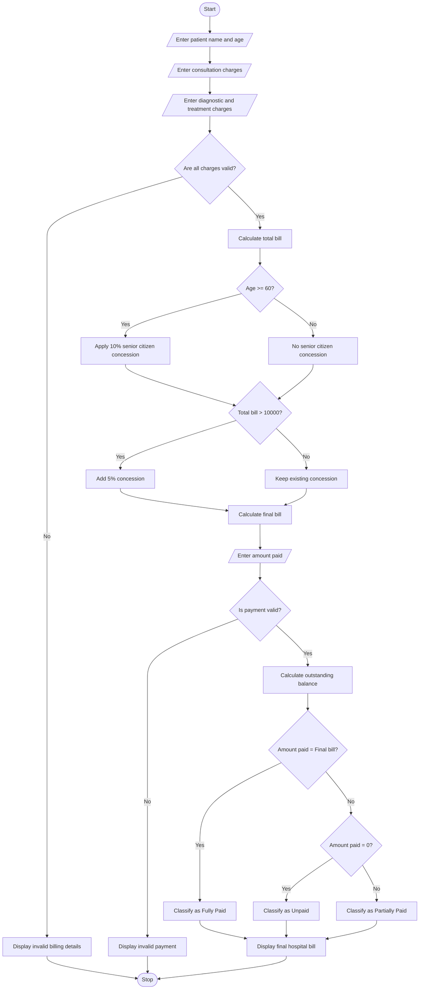

# Hospital Billing and Patient Classification System Using Python

## 1. Problem Statement
Hospital Billing and Patient Classification: Process consultation, diagnostic, and treatment charges, apply conditional concessions, validate billing constraints, and classify patients according to a supplied payment policy. 

## 2. Algorithm

1. Start the program.
2. Input patient name and age.
3. Input consultation charges.
4. Input diagnostic charges.
5. Input treatment charges.
6. Validate that all charges are non-negative.
7. Calculate total bill:

\\[ Total = Consultation + Diagnostic + Treatment \\]

8. Check concession eligibility:
   - If age is 60 or above, apply 10% concession.
   - If total bill exceeds ₹10,000, apply 5% concession.
   - If both conditions are satisfied, apply 15% concession.
9. Calculate concession amount.
10. Calculate final bill:

\\[ Final\ Bill = Total - Concession \\]

11. Input the amount paid by the patient.
12. Validate that payment is between zero and the final bill.
13. Classify the patient:

- If payment equals final bill, classify as Fully Paid.
- If payment is greater than zero but less than final bill, classify as Partially Paid.
- If payment is zero, classify as Unpaid.

14. Calculate outstanding balance.
15. Display the complete hospital bill.
16. Stop the program.

## 3. Flowchart Using Mermaid


## 5. Sample Input

```
===== HOSPITAL BILLING SYSTEM =====

Enter patient name: Ravi
Enter patient age: 65
Enter consultation charges: Rs.2000
Enter diagnostic charges: Rs.3000
Enter treatment charges: Rs.7000
```

Payment input:

```
Enter amount paid: Rs.8000
```

## 6. Sample Output

```
===== BILL SUMMARY =====

Patient Name       : Ravi
Patient Age        : 65
Consultation       : Rs.2000.00
Diagnostic         : Rs.3000.00
Treatment          : Rs.7000.00
Total Bill         : Rs.12000.00
Concession Rate    : 15%
Concession Amount  : Rs.1800.00
Final Bill         : Rs.10200.00

===== PAYMENT DETAILS =====

Amount Paid        : Rs.8000.00
Outstanding Balance: Rs.2200.00
Patient Category   : Partially Paid

===== BILL GENERATED SUCCESSFULLY =====
```

