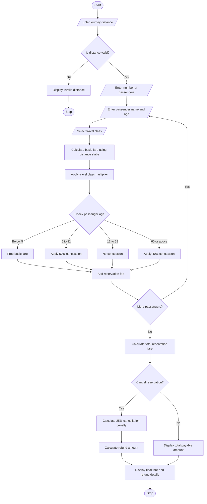

# Railway Fare and Reservation Calculator Using Python

## 1. Problem Statement
 Railway Fare and Reservation Calculator: Calculate fares for multiple passengers using distance 
slabs, travel classes, age-based concessions, reservation fees, and specified cancellation penalties. 
## 2. Algorithm

1. Start the program.
2. Input the journey distance.
3. Validate that the distance is greater than zero.
4. Input the number of passengers.
5. For each passenger:
   - Enter passenger name.
   - Enter passenger age.
   - Select travel class.
6. Calculate the basic fare per kilometre using distance slabs:
   - Up to 100 km: ₹1.00 per km.
   - 101–500 km: ₹1.50 per km.
   - Above 500 km: ₹2.00 per km.
7. Multiply the basic fare by the selected travel class multiplier.
8. Apply age-based concessions:
   - Below 5 years: Free.
   - 5–11 years: 50% concession.
   - 12–59 years: No concession.
   - 60 years or above: 40% concession.
9. Add the reservation fee of ₹40 per passenger.
10. Calculate the total fare for all passengers.
11. Ask whether the passengers want to cancel their reservation.
12. If cancellation is selected:
    - Calculate a penalty of 25% of the ticket fare before reservation fee.
    - Calculate the refund amount.
13. Otherwise, display the total payable amount.
14. Display the passenger-wise fare details and final summary.
15. Stop the program.

## 3. Flowchart Using Mermaid

## 4. Source Code
Save the following program as `railway_fare.py`.

This program uses Python functions, lists, dictionaries, loops, conditional statements, and arithmetic operations.

```
# Railway Fare and Reservation CalculatorRESERVATION_FEE = 40CANCELLATION_RATE = 25CLASS_MULTIPLIERS = {    "sleeper": 1.0,    "ac 3 tier": 1.5,    "ac 2 tier": 2.0,    "ac first class": 3.0}# Calculate fare using progressive distance slabsdef calculate_basic_fare(distance):    if distance <= 100:        fare = distance * 1.0    elif distance <= 500:        fare = (100 * 1.0) + ((distance - 100) * 1.5)    else:        fare = (100 * 1.0) + (400 * 1.5)        fare += (distance - 500) * 2.0    return fare# Calculate age-based concessiondef get_concession(age):    if age < 5:        return 100
```
## 5. Sample Input
```
===== RAILWAY FARE AND RESERVATION CALCULATOR =====

Enter journey distance (km): 650
Enter number of passengers: 2

Passenger 1
Enter passenger name: Ravi
Enter passenger age: 65

Available Travel Classes:
- Sleeper
- Ac 3 Tier
- Ac 2 Tier
- Ac First Class

Select travel class: ac 3 tier

Passenger 2
Enter passenger name: Anu
Enter passenger age: 25

Available Travel Classes:
- Sleeper
- Ac 3 Tier
- Ac 2 Tier
- Ac First Class

Select travel class: sleeper
```

Cancellation input:

```
Do you want to cancel the reservation? (yes/no): yes
```
## 6. Sample Output
```
===== PASSENGER FARE DETAILS =====

Passenger Name : Ravi
Age            : 65
Travel Class   : Ac 3 Tier
Basic Fare     : Rs.1000.00
Class Fare     : Rs.1500.00
Concession     : 40%
Ticket Fare    : Rs.900.00
Reservation Fee: Rs.40.00
Total Fare     : Rs.940.00

Passenger Name : Anu
Age            : 25
Travel Class   : Sleeper
Basic Fare     : Rs.1000.00
Class Fare     : Rs.1000.00
Concession     : 0%
Ticket Fare    : Rs.1000.00
Reservation Fee: Rs.40.00
Total Fare     : Rs.1040.00

Total Reservation Amount: Rs.1980.00

===== CANCELLATION DETAILS =====
Original Booking Amount: Rs.1980.00
Cancellation Penalty   : Rs.475.00
Refund Amount          : Rs.1505.00
Reservation Status     : Cancelled
```


Conclusion: This project provides an efficient way to calculate railway reservation fares, apply passenger concessions, and process cancellation charges automatically.
