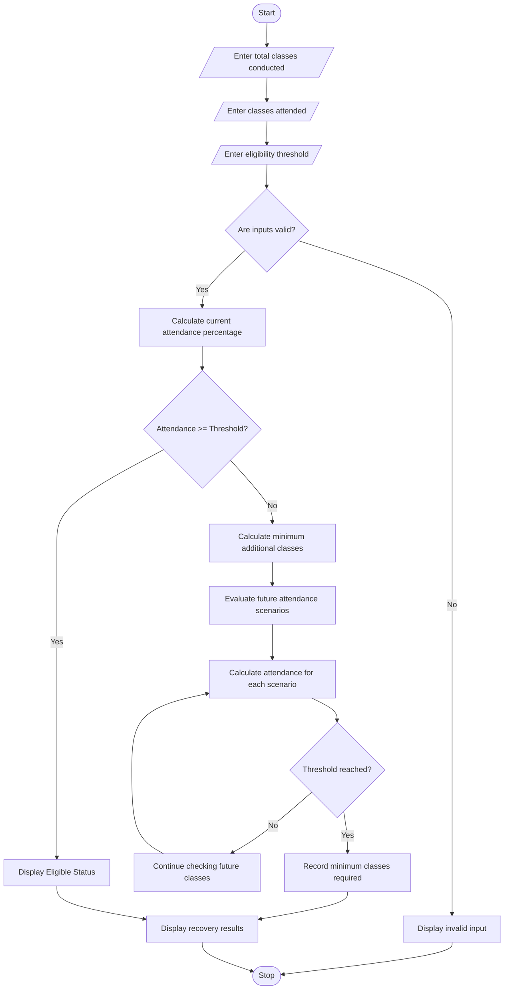

# Attendance Recovery Computation Using Python

## 1. Problem Statement
. Attendance Recovery Computation: Calculate current attendance percentages and determine the 
minimum consecutive classes required to reach an eligibility threshold under different future 
attendance scenarios. 
## 2. Algorithm
1. Start the program.
2. Input the total number of classes conducted.
3. Input the number of classes attended.
4. Validate the input:
   - Total classes must be greater than zero.
   - Attended classes must not exceed total classes.
5. Input the required attendance eligibility percentage.
6. Calculate current attendance percentage:

\\[ Attendance = \frac{Classes\ Attended}{Total\ Classes}\times100 \\]

7. Check whether current attendance meets the eligibility threshold.
8. If attendance is already sufficient, display eligible status.
9. Otherwise, calculate the minimum consecutive classes required using:

\\[ \frac{A+x}{T+x}\times100 \geq R \\]

Where:

- \\(A\\) = Classes attended.
- \\(T\\) = Total classes conducted.
- \\(x\\) = Additional consecutive classes attended.
- \\(R\\) = Required attendance percentage.

10. Calculate the minimum number of classes for each future attendance scenario.
11. Display the required classes and expected attendance percentage.
12. Stop the program.

## 3. Flowchart Using Mermaid


## 4. Sample Input

```
===== ATTENDANCE RECOVERY SYSTEM =====

Enter total classes conducted: 100
Enter classes attended: 65
Enter eligibility threshold (%): 75
```

## 5. Sample Output

```
===== CURRENT ATTENDANCE =====

Total Classes       : 100
Classes Attended    : 65
Current Attendance  : 65.00%
Eligibility Target  : 75.00%

Status: NOT ELIGIBLE

===== FULL ATTENDANCE RECOVERY =====

Minimum consecutive classes required: 40
Expected attendance: 75.00%

===== FUTURE ATTENDANCE SCENARIOS =====

Scenario: Attend every class
Additional classes required: 40
Expected attendance: 75.00%

Scenario: Attend 4 classes, miss 1
Additional classes required: 200
Expected attendance: 75.00%

Scenario: Attend alternate classes
Target not reached within 100000 classes.
```


Conclusion: This system helps students understand their current attendance status and calculate how many additional classes they need to attend to achieve the required eligibility percentage under different attendance scenarios.
