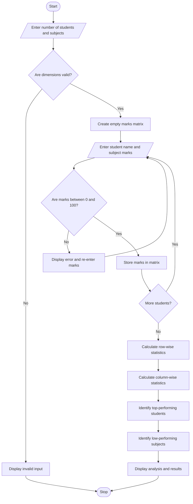

# Student Marks Matrix Analysis Using Python

## 1. Problem Statement
Student Marks Matrix Analysis: Analyse a matrix of student marks across subjects, calculate 
row-wise and column-wise statistics, identify top performers, and detect subjects with low average 
performance. 

## 2. Algorithm
1. Start the program.
2. Input the number of students and subjects.
3. Validate the number of students and subjects.
4. Create an empty two-dimensional marks matrix. Displays the complete marks matrix and statistical results.
5. For each student:
   - Enter the student name.
   - Enter marks in each subject.
   - Validate marks between 0 and 100.
   - Store marks in the matrix.
6. Calculate row-wise statistics:
   - Total marks.
   - Average marks.
   - Maximum marks.
   - Minimum marks.
7. Calculate column-wise statistics:
   - Total marks.
   - Average marks.
   - Maximum marks.
   - Minimum marks.
8. Identify the student with the highest average marks.
9. Identify subjects whose average marks are below 50.
10. Display the marks matrix and statistical results.
11. Stop the program.

## 3. Flowchart Using Mermaid

## 4. Sample Input

```
===== STUDENT MARKS MATRIX ANALYSIS =====

Enter number of students: 3
Enter number of subjects: 3

Enter subject names:
Subject 1: Python
Subject 2: Mathematics
Subject 3: English

Enter details of Student 1
Student name: Anu
Enter marks in Python: 90
Enter marks in Mathematics: 85
Enter marks in English: 80

Enter details of Student 2
Student name: Ravi
Enter marks in Python: 75
Enter marks in Mathematics: 45
Enter marks in English: 60

Enter details of Student 3
Student name: Meena
Enter marks in Python: 65
Enter marks in Mathematics: 40
Enter marks in English: 55
```

## 5. Sample Output

```
===== STUDENT MARKS MATRIX =====

Student  Python  Mathematics  English
Anu      90      85           80
Ravi     75      45           60
Meena    65      40           55

===== ROW-WISE STATISTICS =====

Name    Total   Average  Highest  Lowest
Anu     255     85.00    90.00    80.00
Ravi    180     60.00    75.00    45.00
Meena   160     53.33    65.00    40.00

===== COLUMN-WISE STATISTICS =====

Subject       Total   Average  Highest  Lowest
Python        230     76.67    90.00    65.00
Mathematics   170     56.67    85.00    40.00
English       195     65.00    80.00    55.00

===== TOP PERFORMER(S) =====

Anu - 85.00%

===== LOW-PERFORMING SUBJECTS =====

No low-performing subjects found.

===== ANALYSIS COMPLETED SUCCESSFULLY =====
```

Note: In this sample, Mathematics has an average of 56.67%, so it is not classified as low-performing because the threshold is below 50%.


Conclusion: This system simplifies student performance analysis by automatically calculating statistics and identifying academic strengths and areas that may need improvement.
