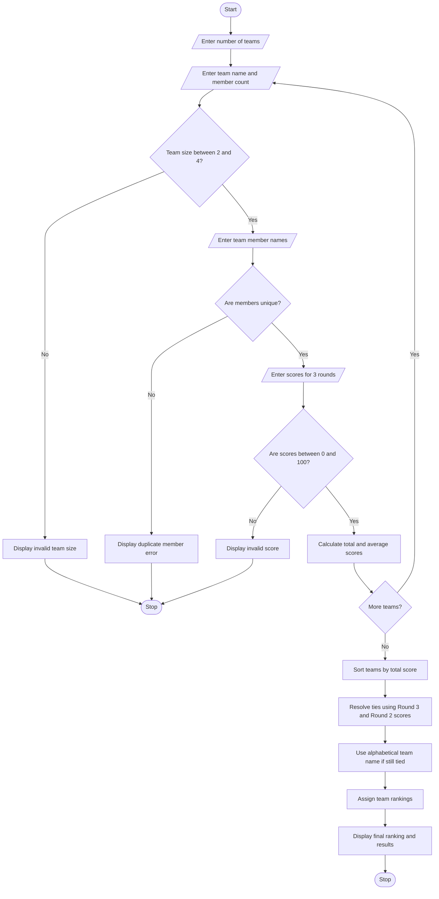

# Hackathon Team Formation and Ranking Using Python

## 1. Problem Statement
Hackathon Team Formation and Ranking: Analyse student scores and team compositions, 
validate team sizes, aggregate round-wise scores, and resolve tied rankings using predefined rules.
## 2. Algorithm

1. Start the program.
2. Input the number of participating teams.
3. Input the minimum and maximum team size.
4. For each team:
   - Enter the team name.
   - Enter the number of team members.
   - Validate that the team size is between 2 and 4.
   - Enter the names of team members.
   - Check that no student is assigned to multiple teams.
5. Input scores for three competition rounds.
6. Validate that every round score is between 0 and 100.
7. Calculate the total score of each team:

\\[ Total = Round1 + Round2 + Round3 \\]

8\. Calculate the average score:

\\[ Average = \frac{Total}{3} \\]

9. Sort teams according to:
   - Total score in descending order.
   - Round 3 score in descending order.
   - Round 2 score in descending order.
   - Team name in alphabetical order.
10. Assign ranks to teams.
11. Display team details, total scores, average scores, and rankings.
12. Stop the program.

## 3. Flowchart Using Mermaid

## 4. Sample Input

```
===== HACKATHON TEAM FORMATION AND RANKING =====

Enter number of teams: 3

Enter details for Team 1
Enter team name: Alpha
Enter number of team members: 3
Enter member 1 name: Anu
Enter member 2 name: Ravi
Enter member 3 name: Kiran

Enter round-wise scores (0-100):
Round 1 score: 80
Round 2 score: 80
Round 3 score: 90

Enter details for Team 2
Enter team name: Beta
Enter number of team members: 2
Enter member 1 name: Meena
Enter member 2 name: Rahul

Enter round-wise scores (0-100):
Round 1 score: 85
Round 2 score: 75
Round 3 score: 90

Enter details for Team 3
Enter team name: Gamma
Enter number of team members: 4
Enter member 1 name: Priya
Enter member 2 name: Arjun
Enter member 3 name: Sita
Enter member 4 name: Karthik

Enter round-wise scores (0-100):
Round 1 score: 80
Round 2 score: 80
Round 3 score: 80
```

## 5. Sample Output

```
===== TEAM PERFORMANCE DETAILS =====

Team Name : Alpha
Members   : Anu, Ravi, Kiran
Round 1   : 80.00
Round 2   : 80.00
Round 3   : 90.00
Total     : 250.00
Average   : 83.33

Team Name : Beta
Members   : Meena, Rahul
Round 1   : 85.00
Round 2   : 75.00
Round 3   : 90.00
Total     : 250.00
Average   : 83.33

Team Name : Gamma
Members   : Priya, Arjun, Sita, Karthik
Round 1   : 80.00
Round 2   : 80.00
Round 3   : 80.00
Total     : 240.00
Average   : 80.00

===== FINAL HACKATHON RANKINGS =====

Rank    Team Name    Total    Average
1       Alpha        250.00   83.33
2       Beta         250.00   83.33
3       Gamma        240.00   80.00

Winner: Alpha

===== RANKING COMPLETED SUCCESSFULLY =====
```

