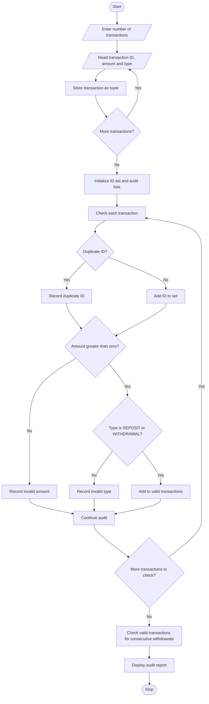

# Tuple-Based Transaction Audit Using Python

## 1. Problem Statement
Tuple-Based Transaction Audit: Process transaction tuples containing identifiers, amounts, and 
transaction types; detect duplicate identifiers, invalid amounts, and suspicious sequences. 
## 2. Algorithm

1. Start the program.
2. Read the number of transactions.
3. Store each transaction as a tuple `(ID, amount, type)` in a list.
4. Create a set to track transaction IDs.
5. For each transaction:
   - Check whether the ID is already present.
   - Check whether the amount is greater than zero.
   - Check whether the transaction type is valid.
   - Record any errors found.
6. Check valid transactions for three or more consecutive withdrawals.
7. Display valid transactions.
8. Display duplicate IDs, invalid transactions, and suspicious sequences.
9. Stop the program.

## 3. Flowchart (Mermaid)


## 4. Sample Input
```
Enter number of transactions: 7

Transaction 1
Enter Transaction ID: T101
Enter Amount: 5000
Enter Transaction Type (DEPOSIT/WITHDRAWAL): DEPOSIT

Transaction 2
Enter Transaction ID: T102
Enter Amount: 2000
Enter Transaction Type (DEPOSIT/WITHDRAWAL): WITHDRAWAL

Transaction 3
Enter Transaction ID: T103
Enter Amount: 1500
Enter Transaction Type (DEPOSIT/WITHDRAWAL): WITHDRAWAL

Transaction 4
Enter Transaction ID: T104
Enter Amount: 1000
Enter Transaction Type (DEPOSIT/WITHDRAWAL): WITHDRAWAL

Transaction 5
Enter Transaction ID: T102
Enter Amount: 3000
Enter Transaction Type (DEPOSIT/WITHDRAWAL): DEPOSIT

Transaction 6
Enter Transaction ID: T105
Enter Amount: -500
Enter Transaction Type (DEPOSIT/WITHDRAWAL): DEPOSIT

Transaction 7
Enter Transaction ID: T106
Enter Amount: 2500
Enter Transaction Type (DEPOSIT/WITHDRAWAL): TRANSFER
``

## 5.. Sample Output
```
========== TRANSACTION AUDIT REPORT ==========

All Transactions:
('T101', 5000.0, 'DEPOSIT')
('T102', 2000.0, 'WITHDRAWAL')
('T103', 1500.0, 'WITHDRAWAL')
('T104', 1000.0, 'WITHDRAWAL')
('T102', 3000.0, 'DEPOSIT')
('T105', -500.0, 'DEPOSIT')
('T106', 2500.0, 'TRANSFER')

Valid Transactions:
('T101', 5000.0, 'DEPOSIT')
('T102', 2000.0, 'WITHDRAWAL')
('T103', 1500.0, 'WITHDRAWAL')
('T104', 1000.0, 'WITHDRAWAL')

Duplicate Transaction IDs:
T102

Invalid Amount Transactions:
('T105', -500.0, 'DEPOSIT')

Invalid Transaction Types:
('T106', 2500.0, 'TRANSFER')

Suspicious Withdrawal Sequences:
[('T102', 2000.0, 'WITHDRAWAL'),
 ('T103', 1500.0, 'WITHDRAWAL'),
 ('T104', 1000.0, 'WITHDRAWAL')]

Audit Completed.
```

Note: The sample output illustrates the intended audit logic. For a stricter implementation, exclude all occurrences of a duplicated ID from valid transactions before checking suspicious sequences.
