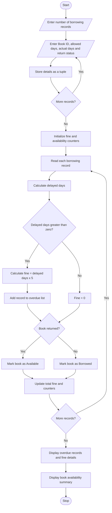

# Library Borrowing and Fine Reconciliation Using Python
## 1. Problem Statement
Library Borrowing and Fine Reconciliation: Analyse tuples representing book identifiers, 
borrowing periods, and return delays; calculate fines, identify overdue records, and reconcile book 
availability. 
## 2. Algorithm
1. Start the program.
2. Read the number of borrowing records.
3. For each record, input Book ID, allowed borrowing days, actual borrowing days, and return status.
4. Store each record as a tuple.
5. Calculate delayed days using:

`Delayed Days = Actual Days - Allowed Days`

6. If delayed days are greater than zero:
   - Calculate fine as delayed days × ₹5.
   - Add the record to the overdue list.
7. If the book is returned, mark it as available; otherwise, mark it as borrowed.
8. Calculate the total fine.
9. Display borrowing records, overdue records, total fines, and book availability.
10. Stop the program.

## 3. Flowchart (Mermaid)


## 4. Sample Input

```
Enter number of borrowing records: 4

Book Record 1
Enter Book ID: B101
Enter allowed borrowing days: 14
Enter actual borrowing days: 16
Has the book been returned? (YES/NO): YES

Book Record 2
Enter Book ID: B102
Enter allowed borrowing days: 7
Enter actual borrowing days: 7
Has the book been returned? (YES/NO): YES

Book Record 3
Enter Book ID: B103
Enter allowed borrowing days: 10
Enter actual borrowing days: 15
Has the book been returned? (YES/NO): NO

Book Record 4
Enter Book ID: B104
Enter allowed borrowing days: 5
Enter actual borrowing days: 3
Has the book been returned? (YES/NO): YES
```

## 5. Sample Output

```
========== LIBRARY AUDIT REPORT ==========

Borrowing Records:
('B101', 14, 16, 'YES')
('B102', 7, 7, 'YES')
('B103', 10, 15, 'NO')
('B104', 5, 3, 'YES')

Overdue Records:

Book ID: B101
Delayed Days: 2
Fine: Rs. 10
----------------------
Book ID: B103
Delayed Days: 5
Fine: Rs. 25
----------------------

Total Fine: Rs. 35

Book Availability:

Available Books:
B101
B102
B104

Currently Borrowed Books:
B103

Total Records: 4
Available Books Count: 3
Borrowed Books Count: 1

Library Reconciliation Completed.
```


Note: This example assumes each Book ID appears only once in the current borrowing records. For a real library system, availability should be tracked using the latest borrowing or return transaction for each book.
