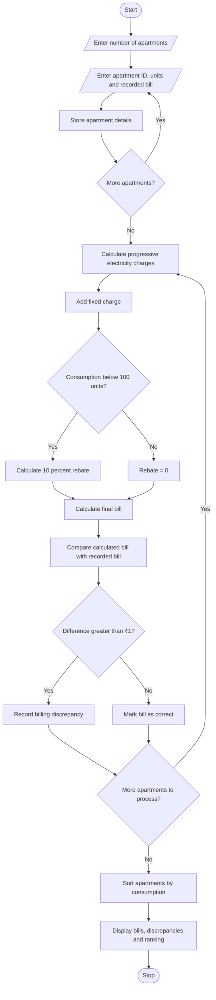

# Smart Electricity Billing for Multiple Apartments Using Python

## 1. Problem Statement

Smart Electricity Billing for Multiple Apartments: Calculate apartment-wise bills using 
progressive tariffs, fixed charges, and rebates; identify billing discrepancies and rank apartments by 
consumption.
## 2. Algorithm

1. Start the program.
2. Read the number of apartments.
3. For each apartment, input:
   - Apartment ID
   - Electricity consumption units
   - Recorded bill amount
4. Calculate electricity charges using progressive tariff slabs:
   - First 100 units at ₹2 per unit.
   - Next 100 units at ₹3 per unit.
   - Remaining units at ₹5 per unit.
5. Add the fixed charge of ₹50.
6. If consumption is below 100 units, calculate a 10% rebate on electricity charges.
7. Calculate the final bill by subtracting the rebate from the total amount.
8. Compare the calculated bill with the recorded bill.
9. Identify apartments with billing discrepancies greater than ₹1.
10. Rank apartments according to consumption in descending order.
11. Display the apartment-wise billing report, discrepancies, and ranking.
12. Stop the program.

## 3. Flowchart (Mermaid)

## 4. Sample Input
```
Enter number of apartments: 4

Apartment 1
Enter Apartment ID: A101
Enter electricity units consumed: 80
Enter recorded bill amount: 194

Apartment 2
Enter Apartment ID: A102
Enter electricity units consumed: 150
Enter recorded bill amount: 400

Apartment 3
Enter Apartment ID: A103
Enter electricity units consumed: 250
Enter recorded bill amount: 800

Apartment 4
Enter Apartment ID: A104
Enter electricity units consumed: 120
Enter recorded bill amount: 300
```

## 5. Sample Output

```
========== ELECTRICITY BILLING REPORT ==========

Apartment ID: A101
Units Consumed: 80.0
Electricity Charge: Rs. 160.0
Fixed Charge: Rs. 50
Rebate: Rs. 16.0
Calculated Bill: Rs. 194.0
Recorded Bill: Rs. 194.0
Difference: Rs. 0.0

Apartment ID: A102
Units Consumed: 150.0
Electricity Charge: Rs. 350.0
Fixed Charge: Rs. 50
Rebate: Rs. 0
Calculated Bill: Rs. 400.0
Recorded Bill: Rs. 400.0
Difference: Rs. 0.0

Apartment ID: A103
Units Consumed: 250.0
Electricity Charge: Rs. 750.0
Fixed Charge: Rs. 50
Rebate: Rs. 0
Calculated Bill: Rs. 800.0
Recorded Bill: Rs. 800.0
Difference: Rs. 0.0

Apartment ID: A104
Units Consumed: 120.0
Electricity Charge: Rs. 260.0
Fixed Charge: Rs. 50
Rebate: Rs. 0
Calculated Bill: Rs. 310.0
Recorded Bill: Rs. 300.0
Difference: Rs. 10.0

========== BILLING DISCREPANCIES ==========

A104 - Calculated: Rs. 310.0 | Recorded: Rs. 300.0 | Difference: Rs. 10.0

========== APARTMENT CONSUMPTION RANKING ==========

1 A103 - 250.0 units
2 A102 - 150.0 units
3 A104 - 120.0 units
4 A101 - 80.0 units

Electricity Billing Analysis Completed.
```

